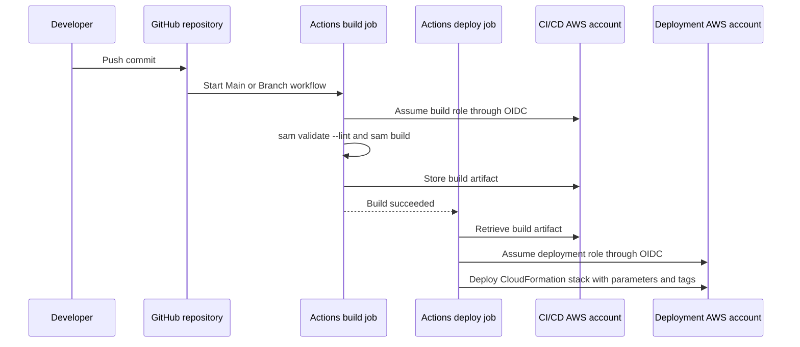
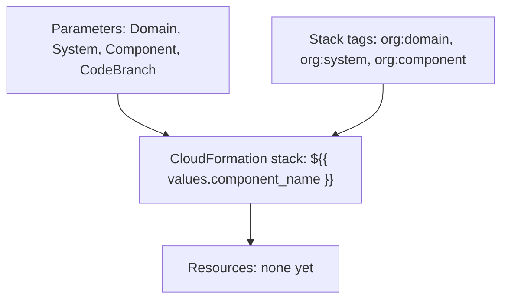

# Architecture

## Infrastructure

### Logical architecture

The generated project has no application architecture yet. It defines how
infrastructure gets from this repository into an AWS account:

- `template.yaml` is the single source of the project's AWS resources.
- Catalog metadata identifies the project's owner, system, and lifecycle.
- GitHub Actions validates and builds the template in a CI/CD account, then
  deploys it as one CloudFormation stack in the deployment account.
- Stack parameters and tags carry domain, system, component, and branch
  metadata into the deployed resources.

#### Deployment flow



The shared actions implement artifact storage and role assumption; their
internals are external to this repository. See [CI/CD pipeline](05-ci-cd.md).

When you add resources, add a logical architecture description and diagram
here: the service's boundaries, its main components, and the data and requests
that flow between them.

### Physical architecture



The deployed stack owns every resource declared in `template.yaml`. At
creation there are none, and the stack cannot be created until you add one.
CI roles, the CI/CD account's artifact storage, and Datadog collection are
external dependencies. Replace this diagram with the resources you add and the
external dependencies they use.

### CloudFormation template

`template.yaml` is the infrastructure-as-code entry point. Its
`Transform: AWS::Serverless-2016-10-31` enables AWS SAM resources, which
CloudFormation expands into the AWS resources needed to deploy the service.

| Section | Purpose |
| --- | --- |
| `Description` | Component name and description from the Backstage form. |
| `Parameters` | Supplies domain, system, and component metadata and the branch slug. |
| `Resources` | Empty in the starter. Declare SAM and CloudFormation resources here. |

Sections you are likely to add:

| Section | Purpose |
| --- | --- |
| `Globals` | Defaults shared by SAM resources, such as function runtime, timeout, memory, and environment variables. |
| `Conditions` | Resource choices that depend on parameters, for example on `CodeBranch`. |
| `Outputs` | Values to report after deployment or export to other stacks, such as endpoints and ARNs. |

Use `Ref` and `Fn::GetAtt` to connect resources without hard-coding generated
names or ARNs.

`cfn-parameters.json` and `cfn-tags.json` provide deployment-action inputs,
while `samconfig.toml` supplies SAM deployment defaults. See
[Configuration](03-configuration.md) for their expression syntax and external
prerequisites. Validate changes with `sam validate --lint` and build with
`sam build` before deployment.

## Software

### Repository file layout

```text
catalog-info.yaml       Backstage Component entity
mkdocs.yml              TechDocs site configuration
docs/handbook/          Handbook pages
README.md               Project entry point
LICENSE                 Project license
template.yaml           SAM infrastructure
cfn-parameters.json     Deployment-action parameter expressions
cfn-tags.json           Deployment-action tag expressions
samconfig.toml          SAM deploy defaults
.cfnlintrc              CloudFormation lint configuration
.gitignore              Ignored build, language, and editor files
.github/workflows/      main.yml and branch.yml
```

These are generated-project paths. The template source repository keeps their
inputs separately under `skeleton/` and `pipeline/` before the scaffolder
combines them.

### Application code

There is no application code, dependency manifest, or test suite. When you add
functions, a layout that keeps each function's code and dependencies separate
lets SAM build a **separate artifact for each function**, so one function's
dependencies do not enlarge every other function's package:

```text
src/handlers/<FunctionName>/   Per-function code and dependency manifest
src/common/                    Shared code, if any
tests/unit/                    Unit tests
data/                          Test events and fixtures
```

Point each function's SAM `CodeUri` at its own directory. Document the chosen
runtime, dependency manager, test framework, and the anatomy of a function and
test in this section once they exist. See
[Common tasks](07-common-tasks.md#add-a-function).
